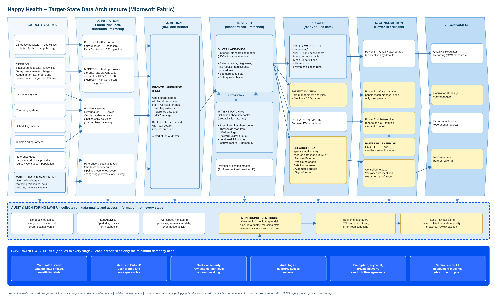

# Happy Health – Unified Data Platform on Microsoft Fabric


> **Reference implementation of the Happy Health data platform design**: 17 hospitals on two record systems (12 on Epic FHIR R4, 5 acquired hospitals on MEDITECH HL7v2), patient matching without a shared ID, five CMS quality measures in 120 days, and auditable, versioned results. Everything runs on a synthetic dataset, so the logic can be checked on a laptop before it touches patient data.

---

## The problem

Happy Health has 12 hospitals on Epic and has just acquired 5 hospitals on MEDITECH, with no shared patient identifier. Four groups need one platform: quality reporting (five CMS measures, automated and auditable within 120 days), the ACO's population health team, department leaders who want self-service dashboards, and an NGO that needs a provably de-identified research extract. Read the full [problem statement](docs/problem.md).

**Documents:** [solution design (PDF)](docs/downloads/HappyHealth_Solution_Design.pdf) · [problem statement (PDF)](docs/downloads/HappyHealth_Problem_Statement.pdf) · [patient 360 design (PDF)](docs/downloads/HappyHealth_Patient360_ACO_Data_Design.pdf)

---

## What this repository contains

* **Documentation** of the target architecture, data model, patient matching, measures, governance, plan and risks, with architecture decision records.
* **Synthetic data in every layer**: Epic FHIR NDJSON and MEDITECH HL7v2 batch files (bronze), FHIR-shaped tables and identity tables (silver), and the quality star schema with measure results (gold), all generated from one workbook.
* **Fabric notebooks** (PySpark and Python) for each step: Epic bulk export, MEDITECH conversion, bronze to silver, Splink matching with link-version publishing, the star schema, the five measures, and the de-identified research extract.
* **A tested Python package** (`happy_platform`) with the reference rules. **23 tests** prove the layers agree and the measures reproduce the workbook exactly.
* **Templates**: pipelines, semantic model roles and measures, MDM settings, lakehouse layout and a go-live governance checklist.

---

## Architecture



```
 SOURCES               INGESTION                    BRONZE          SILVER                         GOLD                     CONSUMPTION
 Epic (FHIR R4)  ──▶  Python notebook: bulk export ─┐
 MEDITECH (HL7v2)  ──▶  FHIR Converter ───────────────┼─▶ raw files ──▶ FHIR-shaped tables ─────────▶ quality star schema ───▶ Power BI (Direct Lake)
 Lab, pharmacy,  ──▶  Mirroring, shortcuts,         │   exactly as    + data-quality rules           + frozen calculation runs   Quality, ACO, operations
 scheduling,          Fabric Pipelines ─────────────┘   received      + Splink patient matching ───▶ patient 360 (after day 120)
 claims                                                               + versioned patient links ───▶ research extract (Safe Harbor) ──▶ NGO
 MDM settings (Profisee): matching thresholds, measure parameters
 ─────────────────────────────── audit & monitoring: run and error logs from every notebook ───────────────────────────────
 ─────────────────── governance: Purview labels · Entra ID · workspace roles · row- and column-level security ───────────────────
```

Read [docs/architecture.md](docs/architecture.md) for each stage.

---

## Repository structure

```
happy-health-fabric-platform/
├── README.md
├── docs/
│   ├── problem.md                     ← the problem statement
│   ├── architecture.md                ← seven stages, audit and governance layers
│   ├── architecture-decisions.md      ← ADR-001 … ADR-012: why each choice was made
│   ├── data-model.md                  ← quality star schema, generalized measure results
│   ├── measures.md                    ← exact rules for the five measures, results on the samples
│   ├── patient-matching.md            ← Splink, review queue, link versions, sample records
│   ├── governance-and-security.md     ← access model, de-identification, security steps, CoE
│   ├── workspace-and-capacity.md      ← environments, F SKU sizing and cost
│   ├── naming-conventions.md
│   ├── lineage.md                     ← every gold field traced to Epic, MEDITECH and other sources
│   ├── assumptions.md · plan-and-risks.md · patient-360.md
│   ├── downloads/                     ← solution design, problem statement and patient 360 design as PDF
│   └── images/
├── diagrams/                          ← draw.io sources (open in draw.io or Lucidchart)
├── samples/
│   ├── bronze/epic_fhir/              ← Patient, Encounter, Condition NDJSON
│   ├── bronze/meditech_hl7v2/           ← nightly ADT^A03 batch files with DG1 and ZET segments
│   ├── silver/clinical/               ← patient, encounter, edTrackingEvent, condition, sepsisEpisode
│   ├── silver/identity/               ← dimPatientSource, dimPerson, bridgePatientLinkHistory, linkVersion, review queue, scored pairs
│   ├── gold/                          ← star schema, dimCalculationRun, factMeasureResult, factMeasureSummary
│   ├── reference/expected_results.json
│   └── HappyHealth_CMS_Measures_Synthetic_Data.xlsx   ← the workbook everything is generated from
├── notebooks/
│   ├── 00_epic_fhir_bulk_export.ipynb
│   ├── 01_meditech_hl7v2_to_fhir.ipynb
│   ├── 02_bronze_to_silver_fhir.ipynb
│   ├── 03_patient_matching_splink.ipynb
│   ├── 04_silver_to_gold_star_schema.ipynb
│   ├── 05_measure_calculation.ipynb
│   ├── 06_research_deidentification.ipynb
│   └── 07_delta_maintenance.ipynb
├── src/happy_platform/                 ← reference rules (pure Python + pandas), also packaged as a wheel for Fabric
├── tests/                             ← pytest suite
├── semantic-model/                    ← TMDL roles and measures, relationships
├── pipelines/                         ← pl_happy_nightly, pl_happy_measures_quarterly (Fabric Git format)
├── templates/                         ← mdm_settings.json, lakehouse_config.json, governance_checklist.md
└── tools/                             ← regenerate samples and notebooks
```

---

## Quick start

```bash
git clone <this repository>
cd happy-health-fabric-platform
pip install -r requirements.txt
pytest                      # 23 tests: layers agree, measures match the workbook, link versions behave
```

**Run the notebooks in Fabric**
1. Create the workspaces and lakehouses in [`templates/lakehouse_config.json`](templates/lakehouse_config.json) (dev uses synthetic data only).
2. Build the wheel (`python -m build`) and attach `happy_platform` to a Fabric environment, together with `splink>=4,<5`, `presidio-analyzer`, `presidio-anonymizer`, `pyjwt[crypto]`.
3. Upload `samples/` and `templates/mdm_settings.json` to the default lakehouse's Files area and import the notebooks. Set `SAMPLES_PATH` to `Files/samples` in the Spark notebooks (02, 04, 05) and to `/lakehouse/default/Files/samples` in the Python ones (01, 03, 06).
4. Run 02 → 04 → 05 with `USE_SAMPLES = True`. Notebooks 04 and 05 end with a reconciliation against the workbook: every gold row and all 91 summary rows must match.
5. Switch `USE_SAMPLES = False` and wire the notebooks into [`pipelines/`](pipelines/) for real sources.

**Change the synthetic data**: edit the workbook, then `python tools/export_samples.py samples/HappyHealth_CMS_Measures_Synthetic_Data.xlsx .`, `python tools/make_bronze.py .` and `pytest`. Edit notebooks in `tools/nb_sources/` and rebuild with `python tools/build_notebooks.py --check`.

---

## Results on the synthetic data

| Measure | Run R-2026Q3-01 (link version 7, submitted) | Run R-2026Q3-02 (link version 8) |
|---|---|---|
| READM-30 30-day readmission | 6 / 42 = **14.3%** | **11.9%** (after a wrong merge was split) |
| SEP-1 sepsis bundle | 5 / 10 = **50%** | 50% |
| ED time to provider | median **46.5 min** | 46.5 min |
| OP-18 arrival to departure | **207 min** main · **127.5 min** mental health | same |
| OP-22 left without being seen | 3 / 41 = **7.3%** | 7.3% |

The two runs differ only in identity. That is the point of the design: submitted numbers stay frozen, and a re-run explains exactly what changed and why. See [docs/measures.md](docs/measures.md).

---

## Key design decisions

| Decision | Choice | Record |
|---|---|---|
| Platform | Microsoft Fabric (one platform, native Power BI, Healthcare Data Solutions) | ADR-001 |
| Layers | Bronze = audit trail, silver = FHIR-shaped and matched, gold = per consumer | ADR-002 |
| Model | Every source converted to FHIR R4 at ingestion | ADR-003, ADR-004 |
| Matching | Splink, thresholds in MDM settings, steward review queue | ADR-005 |
| Identity | Facts store the source record; versioned patient links | ADR-006 |
| Results | Frozen calculation runs pin link, settings and code versions | ADR-007 |
| Measures | One generalized result shape; scoring type picks rate or median | ADR-008 |
| Epic | Python notebook for the bulk export; Clarity mirroring as fallback | ADR-009 |
| Reporting | Star schema, Direct Lake with a fixed identity | ADR-010 |
| Research | Safe Harbor rules plus Presidio, privacy-officer sign-off | ADR-011 |
| Capacity | F64 production with autoscale Spark billing; F32 UAT; F8 dev | ADR-012 |

---

## Governance from day one

* Default sensitivity label "Highly Confidential – PHI" on every data workspace; Purview scans and data loss prevention.
* Business users never hold workspace Contributor or higher (those roles bypass row-level security); they use Power BI apps.
* Every notebook writes run and error rows (`src/happy_platform/audit.py`), so the audit trail exists before the monitoring dashboard does.
* Matching thresholds and measure parameters are versioned settings, approved by stewards and recorded on every run.

Full checklist: [templates/governance_checklist.md](templates/governance_checklist.md).

---

## Technology

| Layer | Technology |
|---|---|
| Platform | Microsoft Fabric (F64 production) |
| Storage | OneLake, Delta tables |
| Ingestion | Fabric Pipelines, OneLake shortcuts, mirroring, Healthcare Data Solutions, Microsoft FHIR Converter |
| Processing | Fabric notebooks (PySpark, Python) |
| Patient matching | Splink 4 on Spark; settings in Profisee |
| De-identification | Safe Harbor rules, Microsoft Presidio |
| Semantic layer | Power BI semantic models (Direct Lake) |
| Governance | Microsoft Purview, Entra ID, OneLake security |

---

## Status and limits

* All data is synthetic: names, record numbers and provider IDs are fake.
* Measure logic is simplified for demonstration (see [docs/measures.md](docs/measures.md)); production logic follows the CMS specification version recorded in `dimMeasure`.
* The PySpark notebooks follow the tested reference rules but must be run in a Fabric workspace; notebooks 01 and 06 also run locally on the samples. Pipeline and TMDL files are templates to validate in the Fabric UI or Tabular Editor before first use.
* Assumptions still to confirm with Happy Health are listed in [docs/assumptions.md](docs/assumptions.md).

---

## About

Designed by **Ruben Sanchez** (November 2026) as a reference solution for Happy Health, a fictional health system. The repository layout follows the pattern of [ndh150/fabric-lakehouse-architecture](https://github.com/ndh150/fabric-lakehouse-architecture).

## License

MIT. See [LICENSE](LICENSE).
