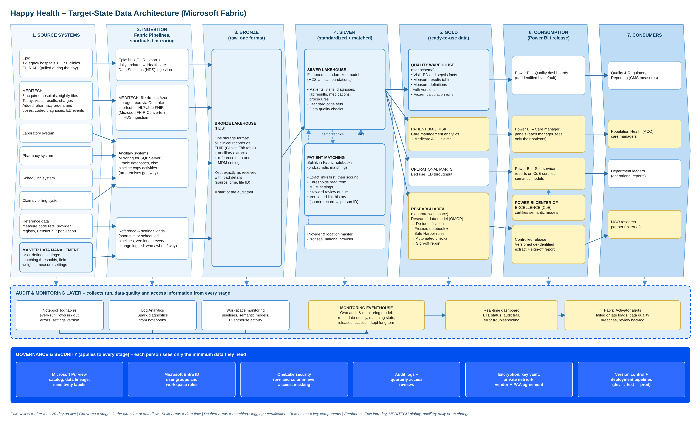

# Target architecture on Microsoft Fabric

> Part of the [Happy Health Fabric platform](../README.md) documentation.

*Pale yellow = after the 120-day go-live. Editable source: [`diagrams/HappyHealth_Target_Architecture_Fabric.drawio`](../diagrams/HappyHealth_Target_Architecture_Fabric.drawio) (opens in draw.io and Lucidchart).*

## Summary: approach and platform choice

> Build one data platform that keeps every source record exactly as it arrived, turns it into one standard model, and matches each patient across every system. Use an open-source storage format and modern analytics architecture that can be shared with multiple workloads. The main focus for the first 120 days is on the five CMS quality measures, because they need the hardest groundwork: patient matching, a clean model of visits and a complete audit trail. Every other group reuses that groundwork later.

**Why Microsoft Fabric**

- One platform for loading, storing, transforming, reporting and alerting. Allows to escalate and supplies on demand upgrade for peak workloads.
- Healthcare Data Solutions provides ready-made pipelines that put Epic and MEDITECH records into one standard format (FHIR)
- Built-in security and governance (Purview, Entra ID, row- and column-level access) to prove each person sees only what they need
- Power BI is part of the platform, so dashboards read the data directly and self-service reports stay safe
- Open table formats and open-source tools (Splink for matching, Presidio for de-identification) limit lock-in

Our approach is to build one platform with three jobs. First, it keeps every record exactly as it arrived from Epic, MEDITECH and the ancillary systems, which gives us the audit trail. Second, it turns those records into one standard model, so a MEDITECH visit and an Epic visit look the same. Third, it matches each patient across all systems, because no shared patient ID exists today.

We spend the first 120 days on the five CMS (Centers for Medicare & Medicaid Services) quality measures because they keep the program funded and need the hardest foundations. Population health, self-service reporting and the research extract all reuse those foundations afterwards.

We recommend Microsoft Fabric for five reasons. It is a single platform covering loading, storage, data engineering, reporting and alerting, which matters on an incremental budget. Its Healthcare Data Solutions module provides tested pipelines for the FHIR healthcare standard. Security and governance are built in through Purview, Entra ID and OneLake security. Power BI is native, so dashboards read the data without copying it. And because tables are stored in an open format and we use open-source tools such as Splink and Presidio, moving later would mean moving storage, not redesigning.

Databricks and Snowflake were credible alternatives. Fabric wins here on having one platform, native Power BI and the healthcare module.

## The complete picture

This diagram shows the target state. Components shaded pale yellow come after the 120-day go-live. Data flows left to right through seven stages, drawn as arrows to show the direction.

Stage 1, sources: Epic at the 12 legacy hospitals and about 150 clinics offers a live FHIR interface. The five MEDITECH hospitals send nightly HL7v2 files, which we assume will be extended with pharmacy, diagnosis and emergency department tracking messages. Four ancillary systems each keep their own patient ID. Reference data supplies measure code lists, and a new master data management (MDM) source holds the settings people control, such as matching thresholds.

Stage 2, ingestion: Fabric Pipelines schedule every load, OneLake shortcuts read data that already sits in cloud storage without copying it, and Mirroring keeps supported databases in sync. Healthcare Data Solutions ingests Epic's FHIR files directly. MEDITECH's HL7v2 messages are converted to FHIR first and then follow the same path.

Stage 3, bronze: every record lands in one storage format, kept exactly as received. This is the start of the audit trail.

Stage 4, silver: records are flattened into a standard model and checked for quality. Splink matches patients across systems using thresholds from the MDM settings.

Stage 5, gold: ready-to-use data for each group, including the quality warehouse and an isolated research area that de-identifies data with Presidio.

Stages 6 and 7: Power BI and a controlled release channel serve the four consumer groups.

Under the stages, the audit and monitoring layer collects run and error information from every stage into its own model, which feeds a real-time dashboard and alerts. The governance and security band applies everywhere.

## Stage 1: source systems

*Eight sources, three ways of connecting, no shared patient ID*

- Epic (12 legacy hospitals + ~150 clinics): live FHIR interface for patients, visits, diagnoses, results, orders and procedures
- MEDITECH (5 acquired hospitals): nightly HL7v2 files, assumed to be extended with pharmacy orders and doses, coded diagnoses and emergency department tracking events
- Laboratory, pharmacy, scheduling and claims systems, each with its own patient ID
- Reference data (measure code lists, provider registry, Census ZIP populations) plus master data management settings such as matching thresholds

> **Key point:** With the MEDITECH files extended, SEP-1 and emergency department time to provider can be calculated at all 17 hospitals.

Stage 1 is the source landscape. The platform adapts to the sources rather than asking them to change, with one exception that we state as an assumption.

Epic covers the 12 legacy hospitals and about 150 clinics. Its live FHIR interface (FHIR is the modern healthcare data standard) gives us patients, visits, diagnoses, lab and vital-sign results, medication orders and procedures.

The five MEDITECH hospitals send nightly HL7v2 files, the older healthcare messaging standard. Today those files cover visits, results and charges only. SEP-1 needs the exact times antibiotics and fluids were given, and emergency department time to provider needs the time a provider first saw the patient. We therefore assume the MEDITECH nightly files are extended with three additions: pharmacy orders and doses given (RDE and RAS messages), coded diagnoses and procedures (DG1 and PR1 segments), and emergency department tracking events such as provider seen, room assigned and decision to admit.

The four ancillary systems each have their own patient ID. Claims uses the insurance subscriber ID, which often belongs to someone other than the patient.

Reference data includes the official measure code lists, the national provider registry and Census ZIP-code populations needed for de-identification. The master data management source holds settings that business users control, not code: matching thresholds, field weights and measure settings. Data stewards own them, and every change is versioned.

## Stage 2: ingestion (pipelines, shortcuts and mirroring)

*One repeatable loading pattern per type of source*

- Epic: a bulk FHIR export loads the history, then daily updates; Healthcare Data Solutions ingests the files
- MEDITECH: files land in Azure storage and are read through a OneLake shortcut; Microsoft's FHIR Converter turns HL7v2 into FHIR, then the same ingestion runs
- Ancillary systems: Mirroring for SQL Server and Oracle databases, otherwise Fabric Pipelines copy activities, through the on-premises gateway
- Reference data and settings arrive through shortcuts or scheduled pipelines; every settings change is logged with who, when and why

> **Key point:** Converting MEDITECH to FHIR first means one ingestion path and one storage format, and the next acquisition reuses it.

Stage 2 brings data into Fabric in three ways: Fabric Pipelines schedule and monitor every load, OneLake shortcuts point to data that already sits in cloud storage without copying it, and Mirroring keeps a near-real-time copy of supported databases.

For Epic, a bulk export pulls the full history as FHIR files, followed by daily updates. Healthcare Data Solutions, Microsoft's healthcare module for Fabric, ingests those files into the bronze layer with its ready-made pipeline.

Healthcare Data Solutions only accepts FHIR files. So for MEDITECH, the nightly HL7v2 files land in Azure storage, which OneLake reads through a shortcut, and Microsoft's open-source FHIR Converter translates each message into FHIR. From that point MEDITECH follows exactly the same ingestion as Epic. That gives us one storage format, and the next acquisition, expected in 12 to 18 months, plugs into the same path. This also allows to change the current feed from MEDITECH to FHIR and more frequent ingestion with minimal changes.

The ancillary systems are kept in sync with Fabric Mirroring where the database supports it (SQL Server and Oracle databases can be mirrored natively), or copied with Fabric Pipelines copy activities, through the on-premises data gateway.

Reference data and master data management settings arrive through OneLake shortcuts or scheduled pipelines. Each approved change to a setting, such as a matching threshold, arrives as a new version with who changed it, when and why, and never overwrites the old value.

Every load writes a record to the monitoring layer: what arrived, how many rows, and whether anything failed.

## Stage 3: bronze

*One storage format, kept exactly as received*

- Healthcare Data Solutions stores every Epic and MEDITECH record as FHIR in one bronze table
- Ancillary extracts, reference data and every version of the settings are kept alongside
- Nothing is updated or deleted, so any number traces back to the original message
- Load details (source, time, file ID) recorded for lineage; old versions can be re-run

> **Key point:** Raw data is never lost, so history can always be recalculated if a rule turns out to be wrong.

Stage 3 is the bronze layer, built by Healthcare Data Solutions. Every clinical record from Epic and from MEDITECH, after conversion, is stored in FHIR format in a single bronze table. Before this design, Happy Health had FHIR from Epic and pipe-delimited HL7v2 files from MEDITECH. Now there is one format.

Ancillary extracts, reference data and every version of the master data management settings sit alongside it in the same lakehouse.

Bronze is append-only. Records are never changed or deleted, which is the foundation of the audit trail: any measure result can be traced back through the layers to the message it came from.

Each record carries load details: source system, time received and file ID. Purview uses these to show lineage. Because tables keep their history, we can reprocess from scratch if a mapping or measure rule turns out to be wrong.

Only the platform engineering team can read bronze, because it holds full patient information. Nobody reports directly from it.

## Stage 4: silver

*One standard model and one view of each patient*

- Healthcare Data Solutions flattens FHIR into simple tables: patients, visits, diagnoses, results, medications, procedures
- Codes mapped to standard code sets; data quality failures set aside and reported, never silently dropped
- Splink in Fabric notebooks match patients across systems using thresholds from the MDM settings
- A versioned link history records which source record belongs to which person

> **Key point:** Records are linked, never physically merged, so a wrong merge can be undone without rewriting history.

Stage 4 is the silver layer, where data becomes consistent and trustworthy.

Healthcare Data Solutions flattens the nested FHIR records into simple tables for patients, visits, diagnoses, lab results, medications and procedures. Codes are mapped to standard code sets for diagnoses, procedures, lab tests and drugs. Data quality rules check completeness, valid codes and times in the right order. Failing records are set aside and reported, never silently dropped.

Next to the clinical tables sits patient matching. We use Splink, an open-source Python library for probabilistic record matching, running in Fabric notebooks. Shared order and visit numbers create certain links first. Splink then scores the remaining candidate pairs field by field. The thresholds that decide link, review or no link are read from the master data management settings rather than written into code, so data stewards can tune them without a release.

The result is a versioned link history: which source record belongs to which person, when that was true, and when we learned it. Records are linked rather than merged, so a wrong merge can be split cleanly. Provider and location data are mastered in Profisee so that doctors and units line up across both systems.

## Stage 5: gold

*Ready-to-use data for each group, all built from silver*

- Quality warehouse: star schema for the five measures, with frozen calculation runs
- Patient 360 / risk view for the population health team, using matched patients and Medicare claims
- Operational marts for bed use and emergency department throughput, reusing the same visit data
- Research area in its own workspace: research data model, Presidio de-identification, automated checks and a sign-off report

> **Key point:** The quality warehouse ships first. It funds the program, and every other mart reuses its foundations.

Stage 5 is the gold layer: ready-to-use data for each consumer, all built from the same silver data so numbers agree across groups.

The quality warehouse is a star schema, described in deliverable 2. Visit, emergency department and sepsis tables feed a patient-level measure results table, which is summarised into a measure summary table; each calculation run is frozen once submitted.

The patient 360 and risk view serves the population health team. It uses Fabric's care management analytics and the Medicare claims files the ACO (accountable care organization) receives, keyed on the matched person, so a patient's history across every facility is visible in one place.

Operational marts for bed use and emergency department throughput reuse the same visit and emergency department tables. That makes them a cheap quick win.

The research area lives in its own Fabric workspace. Data is first shaped into OMOP, the common research data model most research teams expect. It is then de-identified with two tools working together: Safe Harbor rules for the structured fields (dates cut to the year, ages over 89 grouped, ZIP codes cut to three digits) and Microsoft's open-source Presidio library, run in a Fabric notebook, to find and remove names, numbers and other identifiers in any text. Automated checks run on every release and produce a sign-off report for the privacy officer.

## Stage 6: consumption

*The right data for the right person, and no more*

- Quality dashboards in Power BI, reading the data directly; de-identified totals by default
- Care manager panels: row-level security shows each manager only their own patients
- Self-service reports on semantic models certified by the Power BI Center of Excellence, so departments don't need an IT ticket
- Research: a versioned de-identified extract, released only after all checks pass

> **Key point:** Self-service is safe because security lives in the shared models, not in each report.

Stage 6 is how each group uses the gold data. It is also where "minimum necessary" access, the HIPAA rule that people see only the data their job needs, becomes visible.

Quality dashboards run in Power BI on Direct Lake models, which read OneLake directly without copying data. Quality analysts see de-identified totals by default. Seeing patient-level detail needs an approved, time-limited grant.

Care managers use Power BI reports with row-level security tied to the panel assignment table, so each manager sees only the patients assigned to them.

Department leaders build their own reports on shared semantic models certified by the Power BI Center of Excellence (see deliverable 5). Because definitions and security live in the shared model, a new dashboard needs no IT ticket and can't accidentally expose patient information.

The NGO gets no platform access. Instead, a controlled release channel publishes a versioned, de-identified extract, only after every automated check passes and the privacy officer signs off.

Every query and export is logged in the audit and monitoring layer.

## Stage 7: consumers

*Four groups with four different needs, served in priority order*

- Quality & Regulatory: five automated, auditable CMS measures replacing quarterly spreadsheets, first, within 120 days
- Population health team: one risk view of each patient across every facility, for outreach
- Department leaders: bed use and emergency department dashboards without IT tickets
- NGO research partner: a multi-year extract that is provably de-identified under HIPAA Safe Harbor

> **Key point:** Order: quality measures first, an operational quick win next, then population health and research once matching is mature.

Stage 7 is the four groups waiting on the platform, and the order in which we serve them.

Quality and Regulatory reporting comes first. Today they assemble CMS measures by hand from each system every quarter. The platform replaces that with five automated, auditable measures: 30-day readmissions, SEP-1, emergency department time to provider, OP-18 and OP-22 (left without being seen). The 120-day date is fixed because it keeps the program funded.

The population health team wants one risk view of each patient across every facility they've visited, to target outreach. That depends on mature patient matching and claims linkage, so it follows the quality release.

Department leaders want dashboards such as bed use and emergency department throughput. These reuse the tables built for quality, so a first dashboard can ship within the 120 days as a quick win.

The NGO research partner needs a multi-year, de-identified extract for an outcomes study. The NGO is not part of Happy Health's workforce, so the extract must be provably de-identified. It carries the most compliance risk and has no deadline, so it waits until the research ethics approval, the data use agreement and the privacy review are in place.

## Audit & monitoring layer

*Every stage reports in; one model answers "is it running, is it right, who touched it?"*

**Where the information comes from**

- Notebook log tables: every notebook run writes rows in and out, rejected rows, errors and the settings version used
- Log Analytics: Spark diagnostics from notebooks
- Workspace monitoring: logs for pipelines, semantic models and Eventhouse, kept 30 days by default

**What it produces**

- Monitoring Eventhouse: our own audit model of runs, data quality, matching statistics, releases and access, kept for years
- Real-time dashboard: load status by stage and source, late files, error drill-down, audit trail
- Fabric Activator alerts: failed or late loads, data quality breaches, growing review queue, failed de-identification checks

The audit and monitoring layer sits under all seven stages and answers three questions in real time: is the process running, is the data right, and who touched what.

It has three sources. First, notebook log tables: every notebook we write follows a logging standard and records a run ID, start and end time, rows read, written and rejected, errors, data quality results and the version of the master data management settings it used. Second, Log Analytics: Fabric's Spark diagnostic emitter sends notebook logs and metrics there. We need this because Fabric's built-in workspace monitoring doesn't cover notebooks today. Third, workspace monitoring itself, a preview feature that collects logs for pipelines, semantic models and Eventhouse into a read-only database, kept for 30 days by default.

All three feed a monitoring Eventhouse holding our own model: run and step tables, data quality checks, matching statistics (automatic links, items waiting for review, no-links), research releases and access events. Because audits look back years, this model keeps its own long-term history rather than relying on the 30-day default.

On top sit a real-time dashboard, showing load status by stage and source, late files, row-count trends and a drill-down from any error to its log message, and Fabric Activator alerts. Examples: a MEDITECH file hasn't arrived by 6 a.m., more than 2% of rows are rejected, the review queue passes its limit, or a de-identification check fails. Alerts go to Teams or email and can restart a pipeline.

## How this repository maps to the stages

| Stage | Repository |
|---|---|
| 2 Ingestion | `notebooks/00_epic_fhir_bulk_export`, `notebooks/01_meditech_hl7v2_to_fhir`, `pipelines/pl_happy_nightly` |
| 3 Bronze | `samples/bronze/` (FHIR NDJSON, HL7v2 batch files) |
| 4 Silver | `notebooks/02_bronze_to_silver_fhir`, `notebooks/03_patient_matching_splink`, `samples/silver/` |
| 5 Gold | `notebooks/04_silver_to_gold_star_schema`, `notebooks/05_measure_calculation`, `notebooks/06_research_deidentification`, `samples/gold/` |
| 6 Consumption | `semantic-model/` |
| Audit & monitoring | `src/happy_platform/audit.py` (logging standard), `lh_monitoring` tables |
| Governance | `docs/governance-and-security.md`, `templates/governance_checklist.md` |
