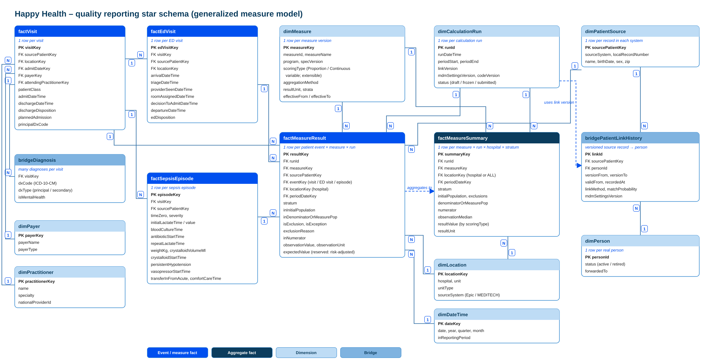

# Data model: quality star schema

> Part of the [Happy Health Fabric platform](../README.md) documentation.

## The five priority measures

*Named in the problem statement, and buildable at all 17 hospitals once the MEDITECH additions arrive*

| Measure | Program | What it needs |
|---|---|---|
| 30-day readmission | CMS readmissions program | Patients readmitted within 30 days of discharge. Needs visit dates, diagnoses and patient matching across sites. |
| SEP-1 sepsis bundle | CMS inpatient reporting | Timely sepsis care: lactate, blood cultures, antibiotics, fluids. Needs the new MEDITECH pharmacy messages; some items confirmed from notes. |
| ED time to provider | Internal (former CMS measure) | Minutes from emergency department arrival to first provider. Needs the new MEDITECH ED tracking events. |
| OP-18: ED arrival to departure | CMS outpatient reporting | Median time in the emergency department for discharged patients. Uses arrival and departure times both systems already send. |
| OP-22: left without being seen | CMS outpatient reporting | Share of emergency department visits where the patient left before being evaluated. Uses the ED disposition both systems already send. |

The problem statement names the five measures. All five use the same visit model and can be built at the 12 Epic hospitals and the 5 MEDITECH hospitals.

30-day readmission is tracked internally using the same method as the CMS Hospital Readmissions Reduction Program. SEP-1 is the sepsis care bundle in CMS inpatient quality reporting. It is chart-abstracted, so even with complete data some items, such as the clinician's note of suspected infection, are confirmed by an abstractor; the platform calculates everything else and pre-fills the case. ED time to provider is the former CMS OP-20, tracked with the same method: minutes from arrival to the first provider.

OP-18 is the median time from emergency department arrival to departure for discharged patients. It needs only arrival and departure times, which both Epic and MEDITECH already send. OP-22 is the share of emergency department visits where the patient left before being evaluated. It needs only the ED disposition, which both systems already send, and reuses the same ED visit table as OP-18. CMS replaces OP-18 and OP-22 from January 2028 with its new Emergency Care Access & Timeliness measure, and our ED table already holds the times that measure needs.

All five reuse the same visit model, which keeps the 120-day build realistic.

*Editable source: [`diagrams/HappyHealth_Quality_Star_Schema.drawio`](../diagrams/HappyHealth_Quality_Star_Schema.drawio).*

## Star schema for quality reporting

We chose a star schema rather than one wide table. The five measures share the same descriptive dimensions: date, location, practitioner, payer and measure. Measure definitions change every year and need versions. And auditors need to trace each number to individual rows, which a single flattened table makes hard.

There are two kinds of fact table. Event facts hold what happened, each at its natural grain: one row per visit, one row per emergency department visit (arrival, triage, provider seen, room assigned, decision to admit, departure), one row per sepsis episode (each bundle step's time).

The core fact is the measure results table (factMeasureResult). Its grain is one row per patient event, per measure, per reporting period, per calculation run. Its fields follow CMS's population model: initial population, denominator (or measure population for median-based measures), exclusion and exception with the reason, numerator, an observation value such as minutes, and a stratum. Fields that don't apply to a measure type stay empty, and expectedValue is reserved for a future risk-adjusted measure. dimMeasure records each measure's scoring type, proportion or continuous variable. The factMeasureSummary table then turns the rows into results, one row per measure, run, hospital and stratum, with a single result formula that applies a rate or a median depending on the scoring type. Adding a measure means a new dimMeasure row and logic that emits standard rows, with no new columns or tables.

On the right is the identity part. Facts point to the source patient record, never directly to the person ID. The patient link history table says which source record belongs to which person, and each calculation run records the link version and settings version it used. The next slide explains why that matters.

Tables are named in camelCase: fact tables start with fact (factVisit, factMeasureResult), dimensions with dim (dimMeasure, dimPatientSource) and bridge tables with bridge (bridgeDiagnosis, bridgePatientLinkHistory). Every relationship is one-to-many, shown as 1 and N on the diagram. Each dimension row, such as one measure, one location or one calculation run, relates to many factMeasureResult rows. Each event row, such as one emergency department visit, can produce many result rows across measures and runs. One visit has many diagnoses in bridgeDiagnosis. factMeasureSummary is built from factMeasureResult (the dashed arrow), and the run's link version points to bridgePatientLinkHistory. And one dimPatientSource record and one dimPerson each have many rows in bridgePatientLinkHistory over time.

## Patient-level results on the synthetic data

A few rows of `factMeasureResult` for run R-2026Q3-01 ([full file](../samples/gold/factMeasureResult.csv)):

| measureId | hospital | sourcePatientKey | eventKey | stratum | inInitialPopulation | inDenominatorOrMeasurePop | isExclusion | exclusionReason | inNumerator | observationValue |
|---|---|---|---|---|---|---|---|---|---|---|
| READM-30 | H01 | EPIC-10001 | VIS-3001 | All | 1 | 1 | 0 |  | 1 | 14.5 |
| READM-30 | H01 | EPIC-10005 | VIS-3007 | All | 1 | 1 | 0 |  | 1 | 18.4 |
| READM-30 | H04 | EPIC-10006 | VIS-3009 | All | 1 | 1 | 0 |  | 0 |  |
| SEP-1 | H01 | EPIC-10001 | SEP-001 | All | 1 | 1 | 0 |  | 1 |  |
| ED-T2P | H01 | EPIC-10001 | ED-5501 | All | 1 | 1 | 0 |  |  | 24 |
| ED-T2P | H13 | MEDI-88031 | ED-5517 | All | 1 | 0 | 1 | Left without being seen |  |  |
| OP-18 | H01 | EPIC-10001 | ED-5501 | Main (OP-18b) | 1 | 0 | 1 | Not discharged (Admitted) |  |  |
| OP-18 | H13 | MEDI-88031 | ED-5517 | Main (OP-18b) | 1 | 0 | 1 | Not discharged (LWBS) |  |  |
| OP-22 | H01 | EPIC-10001 | ED-5501 | All | 1 | 1 | 0 |  | 0 |  |
| OP-22 | H13 | MEDI-88031 | ED-5517 | All | 1 | 1 | 0 |  | 1 |  |

And the summary they roll up to (hospital = ALL):

| measureId | stratum | initialPopulation | exclusions | denominatorOrMeasurePop | numerator | observationMedian | resultValue |
|---|---|---|---|---|---|---|---|
| READM-30 | All | 46 | 4 | 42 | 6 |  | 0.142857142857143 |
| SEP-1 | All | 12 | 2 | 10 | 5 |  | 0.5 |
| ED-T2P | All | 41 | 3 | 38 |  | 46.5 | 46.5 |
| OP-18 | Main (OP-18b) | 39 | 13 | 26 |  | 207 | 207 |
| OP-18 | Mental health (OP-18c) | 2 | 0 | 2 |  | 127.5 | 127.5 |
| OP-22 | All | 41 | 0 | 41 | 3 |  | 0.0731707317073171 |

## Merges and splits without rewriting history

*Change the links, never the facts*

**How it works**

- Facts store the source patient record (for example, a MEDITECH record number), never the person ID
- The patient link history records each link with "valid from / valid to" and "recorded at" dates
- A merge or split adds a new link version; the old one is ended, not deleted
- Recalculating creates a new calculation run beside the old one

**What an auditor sees**

- Submitted results are frozen and stay exactly as filed
- Every result shows which link version and settings version produced it
- A difference report lists any past number that would change today, and why
- Any result can be rebuilt "as of" the day it was submitted

This is the heart of deliverable 2: how a merged or split patient identity shows up without silently rewriting history.

The rule is to change the links, never the facts. Fact rows store the source patient record, such as MEDITECH record 12345, which never changes. Which person that record belongs to lives in the patient link history, and every link has two sets of dates: when it was true in the real world, and when we recorded it.

Take an example. Last quarter an Epic record and a MEDITECH record were treated as two people, so a readmission across the two hospitals was missed. This quarter matching links them. We add a new link version; we don't edit the old one. When the measure is recalculated, it runs as a new calculation run using the new version. Last quarter's submitted result stays frozen. A difference report shows that last quarter's readmission rate would now be slightly higher, and why.

A split works the same way. The wrong link is ended, a new person ID is issued, and the affected measures are recalculated as new runs.

For an auditor, every number can be rebuilt as of the day it was submitted, using the link version and settings version recorded on its calculation run.
