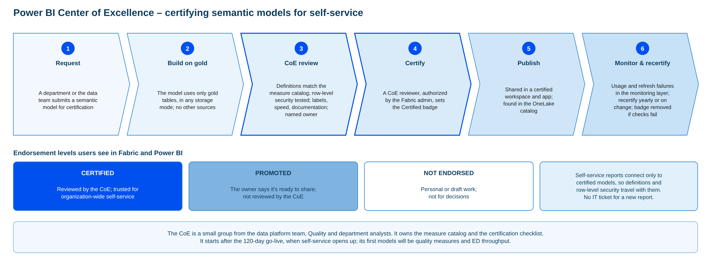

# Governance and security

> Part of the [Happy Health Fabric platform](../README.md) documentation.

## Access scoped by role and panel

*Enforced by the platform, provable to auditors*

**Who sees what**

- Care managers: patient detail, but only for their assigned panel
- Quality analysts: de-identified totals; patient detail only with an approved, time-limited grant
- Department leaders: operational totals; engineers: emergency access only, logged

**How it's enforced**

- Purview sensitivity labels on every patient-information column drive masking automatically
- Entra ID groups, workspace roles, and row- and column-level security in OneLake
- Settings changes approved by stewards; quarterly access reviews; every query logged

The electric-blue band runs under every stage because governance isn't a step you pass through once. It applies everywhere.

Access follows the HIPAA minimum-necessary rule. Care managers see patient detail, but row-level security limits them to their assigned panel. Quality analysts see de-identified totals by default. Patient-level detail needs an approved grant that expires. Department leaders see operational totals. Engineers get emergency access only, and every use is logged.

Enforcement is built into the platform, not left to each report. Microsoft Purview labels every column that holds patient information, and those labels drive masking and access policies automatically. Entra ID groups and Fabric workspace roles control who can open what. OneLake security adds row-level and column-level access.

Three things make it provable. Every query and export is logged in the audit and monitoring layer. Access is reviewed every quarter. And changes to the master data management settings, such as raising a matching threshold, go through steward approval and are versioned, because a threshold change can move a measure result and has to be explainable.

Underneath: encryption, keys held in a key vault, private networking, a signed HIPAA business associate agreement with Microsoft, and version-controlled deployments from development to test to production.

## Proving the research extract is de-identified

*Safe Harbor rules + Presidio, with evidence produced on every release*

**How the data is de-identified**

- Start from an approved list of columns; nothing else can leave
- Safe Harbor rules for structured fields: dates cut to the year, ages over 89 grouped, ZIP cut to 3 digits (000 for small areas)
- Presidio, in a Fabric notebook, finds and removes names, numbers, phones and emails in any text
- Random study IDs replace record numbers and are never derived from them

**Evidence on every release**

- Automated checks: no identifier patterns found, date and ZIP rules met, column list unchanged
- A failed check blocks the release and raises an Activator alert
- Sign-off report: check results, lineage and tool versions, signed by the privacy officer
- Released only through the separate research workspace's controlled channel

The NGO is not part of Happy Health's workforce, so the extract has to be provably de-identified under HIPAA Safe Harbor, not just access-controlled. Safe Harbor means removing 18 kinds of identifier and having no actual knowledge that the remaining data could identify someone.

How it's done. We start from an approved list of columns, and nothing outside it can leave. Structured fields follow Safe Harbor rules: all dates reduced to the year, ages over 89 grouped as 90 or older, ZIP codes cut to three digits and set to 000 where that three-digit area has 20,000 people or fewer, using Census data. Microsoft's open-source Presidio library, run in a Fabric notebook, scans any text for names, record numbers, phone numbers, emails and similar identifiers and removes them. We add custom patterns for Happy Health's own record-number formats. Study IDs are random and never derived from record numbers.

How it's proven. Every release runs automated checks: Presidio and pattern scanners find no identifiers, date and ZIP rules are met, and the column list matches the approved version. A failed check blocks the release and raises an Activator alert. A sign-off report records the check results, lineage and tool versions, and the privacy officer signs it. The extract leaves only through the research workspace's controlled release.

## Steps to apply security in Fabric

1. **Identities (Entra ID).** One security group per role: care managers, care-management leads, quality analysts, quality analysts with a patient-data grant, department leaders, data engineers, data stewards, research release, Center of Excellence. Time-limited patient-data access through access packages that expire; Privileged Identity Management for engineers' emergency access; conditional access (multi-factor sign-in, managed devices).
2. **Tenant settings.** Publish to web and guest access off; sharing outside the organization, export and workspace creation limited. Business associate agreement with Microsoft confirmed for Fabric.
3. **Workspaces as walls.** Separate workspaces for engineering (bronze, silver), gold quality, gold population health, research and report apps, per environment. Only engineers hold Admin, Member or Contributor: **those roles bypass row-level security**. Business users get Power BI apps with audiences.
4. **Network and storage.** Private links, managed private endpoints or the on-premises gateway to reach sources, outbound access restricted; customer-managed keys if policy requires.
5. **Purview labels.** Default label "Highly Confidential – PHI" on data workspaces, mandatory labeling, inheritance to models, reports and exports; data loss prevention policies for Fabric.
6. **Gold tables.** No business access to bronze or silver. On gold SQL endpoints: GRANT/DENY, column-level security, dynamic masking. Avoid SQL row-level security on tables feeding Direct Lake (Direct Lake on SQL falls back to DirectQuery; Direct Lake on OneLake errors). OneLake security roles suit static rules; check their general availability first, and note they can't filter dynamically per user.
7. **Semantic models.** Fixed identity for Direct Lake so users can't bypass the model; roles in [`semantic-model/roles.tmdl`](../semantic-model/roles.tmdl): de-identified, patient-data grant, department leaders, and (patient 360) a dynamic care-manager role on dimPerson. Roles live in Git like code.
8. **Research.** Released extracts only, through the release pipeline (notebook 06) and privacy-officer sign-off; the NGO gets the extract, never a Happy Health workspace role.
9. **Audit.** Purview audit log, workspace monitoring and notebook log tables in the monitoring lakehouse; alerts on permission changes, exports of labeled data and emergency access; quarterly Entra access reviews.
10. **Test.** "View as role", automated row-count tests with test users, a bypass test (SQL endpoint, OneLake, Analyze in Excel), CoE certification and privacy sign-off.

Inside the 120 days: steps 1–7 for the quality model plus the audit logging. Panel roles, research release and self-service certification come after go-live.

## Power BI Center of Excellence: certifying semantic models

*Self-service is safe because every shared model is reviewed before people build on it*

1. Request: a department or the data team submits a semantic model for certification
2. Build on gold: the model uses only gold tables, whatever its storage mode (Direct Lake, import or DirectQuery), with no other sources
3. CoE review: definitions match the measure catalog; row-level security tested with test users; sensitivity labels, speed and documentation checked; a named owner
4. Certify: a CoE reviewer, authorized by the Fabric administrator, sets the Certified badge
5. Publish: shared in a certified workspace and app, and found in the OneLake catalog
6. Monitor and recertify: usage and refresh failures tracked in the monitoring layer; recertified yearly or when the model changes; badge removed if checks fail

Self-service reporting only stays safe if the shared semantic models people build on are correct and secure. The Power BI Center of Excellence (CoE) is the process, and the small team, that makes sure of that. It brings together the data platform team, the Quality team and analysts from the departments, and it owns two things: the measure catalog, meaning the agreed definition of every measure, and the certification checklist.

A model goes through six steps. Anyone can request certification. The model must be built only on gold tables. The storage mode doesn't matter (Direct Lake, import or DirectQuery), but no other sources, side files or private extracts are allowed. The CoE then reviews it: definitions match the measure catalog, row-level security is tested with test users for each role, sensitivity labels are applied, refresh and query speed are acceptable, documentation exists, and a business owner is named. If it passes, a CoE reviewer sets the Certified badge. In Fabric, only people the Fabric administrator authorizes can certify, so the badge means something. The model is then published in a certified workspace and app, and users find it in the OneLake catalog.

Certification isn't permanent. The monitoring layer tracks usage and refresh failures for every certified model. Models are recertified every year or whenever they change, and the badge is removed if a check fails or the owner leaves.

Users see three levels. Certified models are reviewed by the CoE and trusted organization-wide. Promoted models are ones the owner considers ready to share but the CoE hasn't reviewed. Everything else is personal or draft work. Self-service reports connect only to certified models, so definitions and security travel with them and a new report needs no IT ticket. The CoE starts after the 120-day go-live, when self-service opens up, and its first models will be quality measures and emergency department throughput.

## Checklist

See [`templates/governance_checklist.md`](../templates/governance_checklist.md).
