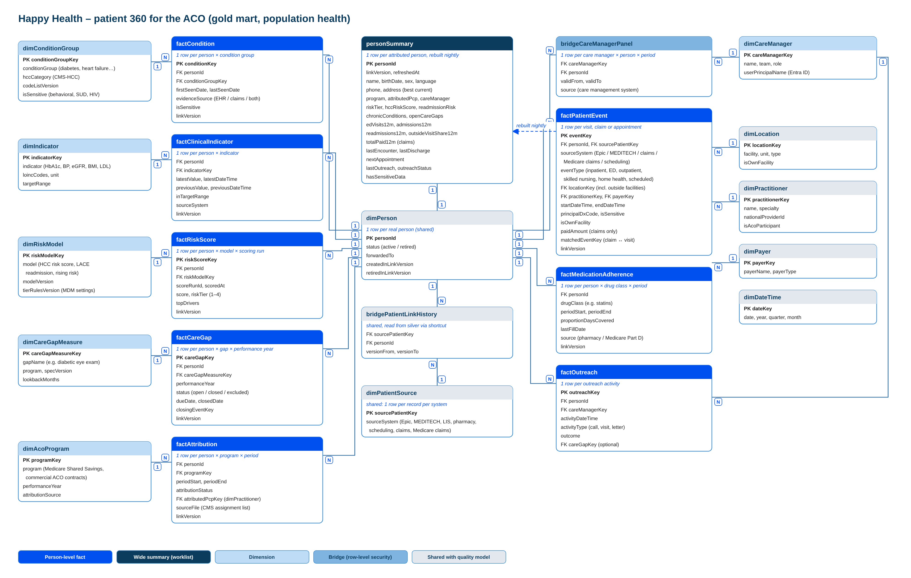

# Patient 360 for the ACO (after day 120)

> Part of the [Happy Health Fabric platform](../README.md) documentation. Design for review; not part of the 120-day build.

*Editable source: [`diagrams/HappyHealth_Patient360_Data_Model.drawio`](../diagrams/HappyHealth_Patient360_Data_Model.drawio).*

## Who it serves

* **Care managers:** patient detail, only for patients on their panel.
* **Care-management leads:** their team's panels, workload and outreach results.
* **ACO medical director and analysts:** totals without names; patient detail only with an approved, time-limited grant.

## Shape

* **Person-level facts keep history:** `factCondition`, `factClinicalIndicator`, `factRiskScore`, `factCareGap`, `factAttribution`, `factPatientEvent` (every visit, claim or appointment, including care outside Happy Health from Medicare claims), `factMedicationAdherence`, `factOutreach`.
* **`personSummary`** is one wide row per attributed patient for the worklist (risk tier, open gaps, admissions and ED visits in 12 months, last outreach, next appointment), rebuilt every night from the facts.
* **Shared with the quality model:** `dimPerson`, `dimLocation`, `dimPractitioner`, `dimPayer`, `dimDateTime`, and the identity tables through a OneLake shortcut.
* **`bridgeCareManagerPanel`** drives row-level security (see the care-manager role in [`semantic-model/roles.tmdl`](../semantic-model/roles.tmdl)).

## The main design difference from the quality model

The 360 is an operational view, not a filed number, so it always uses the **latest** published link version and its tables store the person ID directly, with the link version used. When matching publishes a new version the tables are rebuilt from silver, never edited. The quality model keeps the source record on its facts because submitted numbers must never change.

## Example: P-0005 (John Jones)

Visits from the synthetic data: Happy Health North 6–10 July, then a readmission at Riverside 28 July–1 August (found only because link version 7 joined MEDI-88005 to P-0005), and four ED visits in September. Without the match, the Riverside stays would belong to another person, and outreach would miss the pattern.

## Delivery

| Release | Ships |
|---|---|
| 1 (days 121–165) | Attribution, panels and row-level security; Happy Health visits; worklist |
| 2 (days 166–210) | Medicare claims (outside care, cost), conditions, clinical indicators, care gaps |
| 3 (days 211–270) | Risk scores and tiers, medication adherence, outreach tracking, optional real-time admission alerts |
