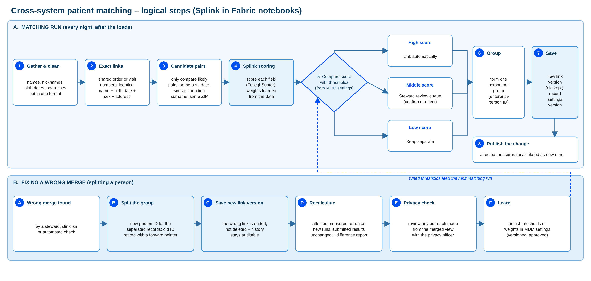

# Patient matching and link versions

> Part of the [Happy Health Fabric platform](../README.md) documentation.

## Logical steps of a match and a split

This diagram shows the logical steps of cross-system patient matching, which runs every night after the loads.

Step 1 cleans the data: names, nicknames, dates of birth and addresses are put in one format.

Step 2 creates certain links first: shared order or visit numbers between the lab system and the electronic record, and identical name, birth date, sex and address.

Step 3 limits comparisons to likely pairs, such as the same birth date, a similar-sounding surname or the same ZIP code, so we don't compare every record with every other.

Step 4 is the Splink scoring. Splink applies the Fellegi-Sunter method: each field contributes a weight depending on how well it agrees, and the weights are learned from Happy Health's own data.

Step 5 compares the total score with two thresholds held in the master data management settings. High scores link automatically. Middle scores go to a review queue worked by Health Information Management data stewards. Low scores stay separate.

Steps 6 to 8 group linked records into one person with a permanent enterprise ID, save a new link version (the old one is kept), and publish the change so the affected measures are recalculated.

The lower lane shows a split, when two merged records turn out to be two people. The group is split, a new ID is issued, the old ID is retired with a forwarding pointer, measures are recalculated as new runs, any outreach based on the wrong merge is reviewed with the privacy officer, and the thresholds are tuned. Those tuned thresholds feed the next matching run.

## Splink approach and handling uncertainty

*Probabilistic matching in Fabric notebooks, with people deciding the grey zone*

**How Splink is used**

- Runs in a Fabric notebook on Spark, at Happy Health's volumes
- Compares name, birth date, sex, address and phone with fuzzy similarity levels
- Learns field weights from Happy Health's own data, then checks them against a hand-labelled sample
- Reports precision and recall, not just a "match rate"; version pinned for repeatable results
- Social Security number, if a source has it: one weighted field, placeholders filtered out, never decisive on its own

**Uncertain matches and wrong merges**

- Two thresholds from MDM settings: link, review or keep separate
- A false merge is worse than a missed link, so thresholds start cautious
- Claims subscriber ID is never used alone, because it can belong to a family member
- Wrong merges are split cleanly: new ID, old ID forwarded, measures re-run, privacy review

We use Splink, an open-source Python library for probabilistic record matching, in a Fabric notebook on the Spark engine, which handles Happy Health's volumes comfortably.

Each pair of candidate records is compared field by field: name with fuzzy similarity levels, so "Jon" and "John" score partly, plus birth date, sex, address and phone. Splink learns how much each level of agreement should count by estimating the weights from Happy Health's own data, using a statistical method called expectation-maximization. We then check the results against a hand-labelled sample of Epic and MEDITECH pairs, and report precision (how many links are right) and recall (how many true links we found), not a vague "match rate". The Splink version is pinned so results are repeatable. A new major version was released in September 2026, so we would test it before upgrading.

Handling uncertainty: two thresholds, stored in the master data management settings, split pairs into link, review and keep separate. The two kinds of error have different costs. A false merge mixes two people's records, a safety and privacy problem. A missed link undercounts readmissions. So thresholds start cautious and are tuned with stewards.

Claims are a special case: the insurance subscriber ID can belong to a parent or spouse, so it's never used alone.

The problem statement's source reference doesn't list Social Security numbers in any source, so the design doesn't depend on them. If a source does carry them, we add the number as one weighted field in Splink, not as a deciding key. In healthcare it's often missing (newborns, some immigrants, patients who decline, unidentified emergency patients), often wrong (placeholders such as 000-00-0000, typos, a parent's number on a child's record) and sometimes shared through identity theft. Splink handles this well: a missing value adds no evidence, a one-digit difference counts as partial agreement, and common placeholder values are filtered out or given little weight. An SSN match with a different name and birth date still goes to review. Because it's highly sensitive, we bring in only what's needed, possibly the last four digits, keep it in restricted columns excluded from all reports and the research extract, and agree with the privacy officer whether to tokenize it, which is safer but allows exact matches only.

When a merge turns out wrong, the person is split cleanly, as shown on the previous slide. A commercial matching product can replace the matching engine later behind the same link history, without changing the data model.

## Sample records the process produces

From [`samples/silver/identity/`](../samples/silver/identity/); the same records drive the measure examples.

### Scored candidate pairs

| Matching run · settings | Record A (Epic) | Record B (MEDITECH) | How the fields compare | Probability | Outcome |
|---|---|---|---|---|---|
| 1 May 2026 · MDM-1 | EPIC-10015 Joseph Thomas, 22 Feb 1946, M, 33399 | MEDI-88015 Joseph Thomas, 22 Feb 1946, M, 33399 | All fields identical | 1.00 | Linked by the exact rule (step 2) to person P-0015; link version 1 |
| 1 May 2026 · MDM-1 | EPIC-10012 Barbara Gonzales, 22 Jan 1964, F, 33247 | MEDI-88012 Barbara Gonzalez, 22 Jan 1965, F, 33401 | Surname one letter apart; birth year one apart; same phone; different ZIP | 0.97 | Above the 0.95 auto-link threshold, linked to P-0012 (later found wrong) |
| 1 May 2026 · MDM-1 | EPIC-10005 John Jones, 21 Jun 1956, M, 33963 | MEDI-88005 John Jones, birth date not yet sent, M, 33963 | Very common name, so it carries little weight; no birth date; different phone | 0.12 | Below 0.50, kept separate as new person P-0041 |
| 29 Sep 2026 · MDM-2 | EPIC-10005 John Jones, 21 Jun 1956, M, 33963 | MEDI-88005 John Jones, 21 Jun 1956, M, 33963 | Birth date now received and identical; phone still different; weights retrained | 0.81 | Review band (0.50–0.95); steward confirmed; P-0041 retired into P-0005; link version 7 |
| 14 Oct 2026 · MDM-3 | EPIC-10012 Barbara Gonzales, 22 Jan 1964, F, 33247 | MEDI-88012 Barbara Gonzalez, 22 Jan 1965, F, 33401 | Same fields; shared phone now weighs less and a different birth year counts against | 0.38 | Steward confirmed the split; new person P-0042; link version 8 |

### Steward review queue

| reviewId | recordA | recordB | matchProbability | decision | reason | decidedAt | publishedInLinkVersion |
|---|---|---|---|---|---|---|---|
| RV-0193 | EPIC-10005 | MEDI-88005 | 0.81 | Same person - link | Same address and next of kin in both charts | 2026-09-29T16:40 | 7 |
| RV-0207 | EPIC-10012 | MEDI-88012 | 0.38 | Different people - split | Care manager reported mixed history; birth certificates differ | 2026-10-14T15:05 | 8 |

### Link history rows (bridgePatientLinkHistory)

| linkId | Source record | Person | version From | version To | Valid from | Recorded at | Method | Prob. | Settings |
|---|---|---|---|---|---|---|---|---|---|
| LK041 | MEDI-88015 | P-0015 | 1 | 999 | 01 May 2026 | 01 May 2026 02:00 | Exact | 1.00 | MDM-1 |
| LK042 | MEDI-88005 | P-0041 | 1 | 6 | 01 May 2026 | 01 May 2026 02:00 | No match | 0.12 | MDM-1 |
| LK043 | MEDI-88005 | P-0005 | 7 | 999 | 28 Jul 2026 | 30 Sep 2026 03:00 | Steward | 0.81 | MDM-2 |
| LK044 | MEDI-88012 | P-0012 | 1 | 7 | 01 May 2026 | 01 May 2026 02:00 | Scored | 0.97 | MDM-1 |
| LK045 | MEDI-88012 | P-0042 | 8 | 999 | 20 Aug 2026 | 15 Oct 2026 03:00 | Steward (split) | 0.00 | MDM-3 |

### Persons (dimPerson)

| personId | Status | Forwarded to | Source records in the latest link version |
|---|---|---|---|
| P-0005 | Active |  | EPIC-10005, and MEDI-88005 from link version 7 |
| P-0012 | Active |  | EPIC-10012 only, from link version 8 |
| P-0041 | Retired | P-0005 | Retired in link version 7 when MEDI-88005 was matched to P-0005 |
| P-0042 | Active |  | Created in link version 8 when MEDI-88012 was split from P-0012 |

These records come from the synthetic data workbook, so they line up with the measure examples. The MEDI-88005 link is why the readmission at the MEDITECH hospital counts in run R-2026Q3-01 (14.3%), and the MEDI-88012 split is why the re-run R-2026Q3-02 shows 11.9%.

Each nightly run writes three kinds of record. First, scored candidate pairs: every likely pair found in step 3, how each field compares, the match probability and the outcome. They're kept, so anyone can see why two records were or weren't linked. Second, review queue items for pairs in the middle band, with the steward's decision and reason. Third, whenever something changes, a new link version: new rows in bridgePatientLinkHistory and, where needed, new or retired person IDs in dimPerson.

The settings versions come from the master data management source. MDM-1 used starting weights, linking automatically at 0.95 or above and sending pairs from 0.50 to the review queue. MDM-2 retrained the field weights on Happy Health's own data. MDM-3, approved after the wrong merge, gave a shared phone number less weight, because family members often share one, and made a different birth year count against a match, so the Gonzales and Gonzalez pair now scores 0.38.

## Link versions: where the number lives, when it changes, how it's kept

The version number is produced by the matching process itself, never typed by a person.

| Table (lh_silver_identity) | Role of the version |
|---|---|
| `linkVersion` (control) | One row per version: status (building / published / failed), publishedAt, matchingRunId, mdmSettingsVersion, counts, approvedBy |
| `bridgePatientLinkHistory` | Each row is true from `versionFrom` to `versionTo`; 999 = still current |
| `dimPerson` | Status and forwarding pointer for retired person IDs |
| `dimCalculationRun` (gold) | `linkVersion` pins the identity state a measure run used |

**When it goes up.** Each night after the loads, notebook 03 scores pairs and applies the day's steward decisions, then compares the result with the latest published state. No change means no new version. Otherwise the next number is the highest published version + 1, at most one per night (an urgent wrong-merge fix can trigger an extra publish).

**How it's kept safe.** Old rows are closed (`versionTo = N − 1`) and new rows added (`versionFrom = N`); nothing is deleted. Validation checks one open row per record and no person without records. The control row is flipped to *published* last: that flip is the commit point, and readers only use published versions, so a half-built version is invisible. A failure marks the version *failed* and restores the tables with Delta `RESTORE`. The matching job runs with concurrency 1, so two runs can't take the same number.

**Why the sample jumps from 1 to 6.** A version is a release number for the whole identity state. Versions 2–6 changed patients outside the 43 sample records, so those records keep one row across the range (for example LK042: MEDI-88005 → P-0041, versions 1–6). See [`linkVersion.csv`](../samples/silver/identity/linkVersion.csv).

The rules are implemented in [`src/happy_platform/identity.py`](../src/happy_platform/identity.py) and tested in [`tests/test_identity.py`](../tests/test_identity.py), which replays the version 7 match and the version 8 split.

## Matching settings

Thresholds and field rules are versioned settings in the MDM source: see [`templates/mdm_settings.json`](../templates/mdm_settings.json).
