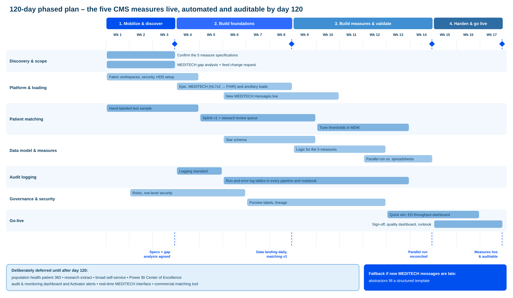

# 120-day plan and risks

> Part of the [Happy Health Fabric platform](../README.md) documentation.

## Four phases to five live measures

The plan has four phases across 17 weeks (120 days).

Phase 1, weeks 1 to 3: mobilize and discover. Confirm the exact specifications of the five measures with the quality team, and complete the MEDITECH gap analysis and change request so work on the feed additions can start. Set up the Fabric workspaces, security and Healthcare Data Solutions, and start a hand-labelled sample for testing matching.

Phase 2, weeks 4 to 8: build foundations. Daily loads from the 12 Epic hospitals, the 5 MEDITECH hospitals (converted from HL7v2 to FHIR) and the ancillary systems. Splink matching version 1 with the steward review queue. The logging standard, so every notebook reports to the monitoring layer from day one. Roles and row-level security.

Phase 3, weeks 9 to 14: build and validate the measures. Star schema and the logic for the five measures. Most important is a side-by-side run against last quarter's spreadsheets in weeks 12 to 14, where every difference is explained with clinical experts.

Phase 4, weeks 15 to 17: harden and go live. Sign-off, the quality dashboard and the runbook, plus a quick win for department leaders, an emergency department throughput dashboard built from the same tables.

Milestones: specifications and gap analysis agreed by week 3, data landing daily with matching version 1 by week 8, side-by-side check reconciled by week 14, measures live and auditable by week 17.

## What ships, what waits, and why

*The deadline funds the program, so everything in the 120 days serves the five measures*

**Ships within 120 days**

- Five CMS measures, automated and auditable, checked against last quarter
- Daily loads from all sources in one format, with patient matching version 1
- Logging standard: every pipeline and notebook writes run and error records, so the audit trail exists from day one
- Quick win: emergency department throughput dashboard for department leaders

**Deliberately deferred**

- Population health patient 360: needs mature matching and claims linkage
- Research extract: highest compliance risk, no deadline, needs ethics approval and a data use agreement
- Broad self-service, a real-time MEDITECH interface, and a commercial matching product decision
- Power BI Center of Excellence, which starts when self-service opens up after go-live
- Audit & monitoring dashboard and Activator alerts, built on the log tables collected from day one

Why this split is right. The 120-day deadline is what funds the program, so everything inside the 120 days serves the five measures, and the measures need exactly the foundations every other group will reuse: loading, one storage format, patient matching, the visit model and the audit trail.

What ships: the five measures, automated and auditable, reconciled against last quarter's manual numbers. Daily loads from every source in one format. Patient matching version 1 with a review queue. The logging standard, so every run is recorded for the audit trail from day one. And one quick win for department leaders, an emergency department throughput dashboard that costs little because it reuses the measure tables.

What waits, and why. The population health patient 360 needs mature matching and the claims linkage, which improve after go-live. The research extract carries the most compliance risk, has no deadline and needs ethics approval, a data use agreement and privacy review first. Broad self-service, a real-time MEDITECH interface and the decision on a commercial matching product are all worth doing, but none is needed for the measures. The Power BI Center of Excellence also waits: until self-service opens up, the data team publishes the quality and emergency department dashboards itself, so there is nothing to certify yet. The audit and monitoring dashboard and its Activator alerts wait too. The log tables they read are collected from day one, so nothing is lost, and the team checks runs directly in the meantime.

If the MEDITECH feed additions arrive late, the measures still go live: abstractors fill a structured template for the missing items, which is loaded into the pipeline and stays auditable, and it is retired once the feeds arrive.

## Bonus: ED throughput dashboard

*A quick win for department leaders, built from the tables the measures already use*

| View | Calculated from | Why it matters |
|---|---|---|
| ED arrivals by hour and day of week | arrivalDateTime | Staffing and peak demand |
| Median arrival → provider (minutes) | arrival, providerSeen | Same logic as the ED time-to-provider measure |
| Median arrival → departure, discharged patients | arrival, departure, disposition | Same logic as OP-18 |
| Median ED time, admitted patients | arrival, departure | The longer stays OP-18 leaves out |
| Boarding time (decision to admit → departure) | decisionToAdmit, departure | Shows inpatient bed pressure |
| Left without being seen rate | edDisposition | Same logic as OP-22 |
| Disposition mix (discharged, admitted, transferred, LWBS, AMA) | edDisposition | Overall flow |
| ECAT readiness: share of visits waiting > 1 h for a room, boarding > 4 h, or in the ED > 8 h | roomAssigned, decisionToAdmit, departure | Previews the CMS measure that replaces OP-18 and OP-22 in 2028 |

**Ground rules**

- Totals and medians only, no patient names: department leaders don't need patient detail, so it follows the minimum-necessary rule
- Built and published by the data team, not self-service; the Center of Excellence and certified self-service come after day 120
- Freshness: Epic hospitals update during the day; the five MEDITECH hospitals show yesterday's data until a real-time MEDITECH feed exists
- MEDITECH dependency: provider-seen, room and boarding times at the MEDITECH hospitals need the new ED tracking events; until then those hospitals show volumes, arrival-to-departure and LWBS only, flagged as partial

Ground rules: Totals and medians only, no patient names: department leaders don't need patient detail, so it follows the minimum-necessary rule; Built and published by the data team, not self-service; the Center of Excellence and certified self-service come after day 120; Freshness: Epic hospitals update during the day; the five MEDITECH hospitals show yesterday's data until a real-time MEDITECH feed exists; MEDITECH dependency: provider-seen, room and boarding times at the MEDITECH hospitals need the new ED tracking events; until then those hospitals show volumes, arrival-to-departure and LWBS only, flagged as partial.

What it doesn't include: A live tracking board of patients currently in the ED (Epic already provides one); Staffing or cost data; Inpatient bed occupancy, the other half of the operational marts, which comes after the 120 days.

Why it's a cheap quick win: every number reuses factEdVisit and the logic already built for ED time to provider, OP-18 and OP-22. The only new work is the report itself, a few days of effort in weeks 13 to 16. It also previews the Emergency Care Access & Timeliness measure that CMS makes mandatory in 2028, so department leaders see those numbers well before they are reported.

## Risks and mitigations

| Risk | Mitigation |
|---|---|
| MEDITECH feed additions arrive late or incomplete | Request in week 1; check every field as it arrives; structured abstraction template as a fallback |
| Patient matching errors: false merges harm safety and privacy; missed links undercount readmissions | Cautious thresholds in MDM settings, steward review queue, versioned links, precision and recall reported on every matching run |
| Measure logic doesn't match CMS specifications or last quarter's numbers | Versioned measure definitions, side-by-side run against spreadsheets, sign-off by clinical experts |
| Healthcare Data Solutions is now customer-maintained code | Treat it as owned accelerator code under version control; keep conversions and models in open formats |
| Next acquisition (12–18 months) brings another record system | Convert every source to FHIR at ingestion; matching built for any number of sources; reusable loading pattern |

Five risks we'd flag in our own design.

One: the MEDITECH feed additions arrive late or incomplete. They're needed for SEP-1 and time to provider at five hospitals. We raise the request in week 1, check every field as it arrives, and keep a structured abstraction template ready as a fallback, so the measures still go live.

Two: patient matching errors. A false merge mixes two people's records, a safety and privacy problem. A missed link undercounts readmissions. Mitigations: cautious thresholds held in the master data management settings, a steward review queue, versioned links that make any split clean, and precision and recall reported on every matching run.

Three: measure logic that doesn't match the CMS specification or last quarter's manual numbers. We version every measure definition, run side by side against the spreadsheets, and have clinical experts sign off on every difference.

Four: Healthcare Data Solutions is now delivered as code that Happy Health maintains, following Microsoft's change in delivery model. We treat it as our own accelerator code, keep it under version control, and keep the conversions and models in open formats.

Five: the next acquisition, expected in 12 to 18 months, may bring a third record system. Because every source is converted to FHIR at ingestion, matching handles any number of sources, and loading follows a reusable pattern, a new system becomes configuration work rather than a redesign.
